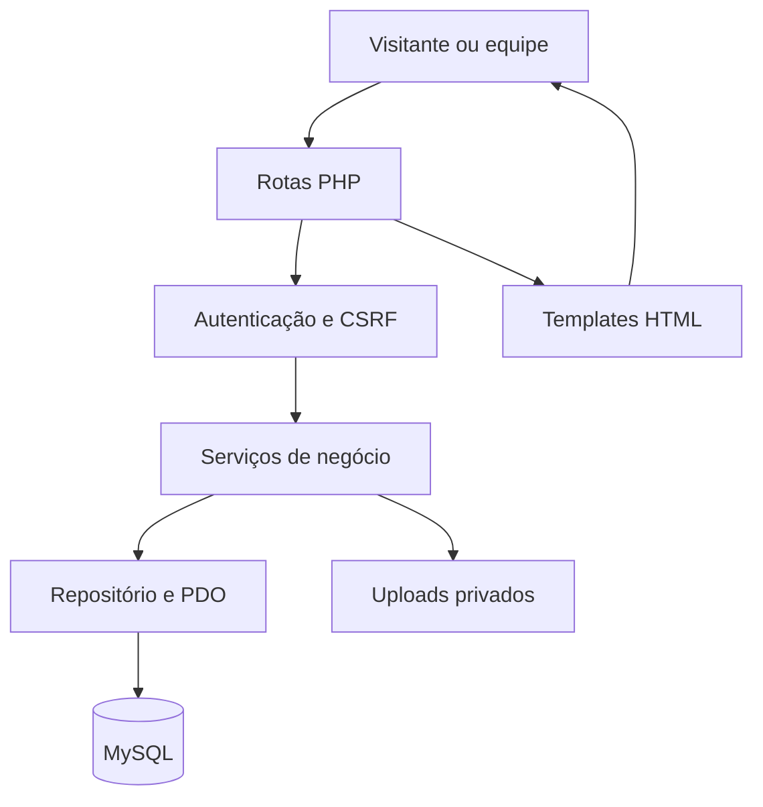
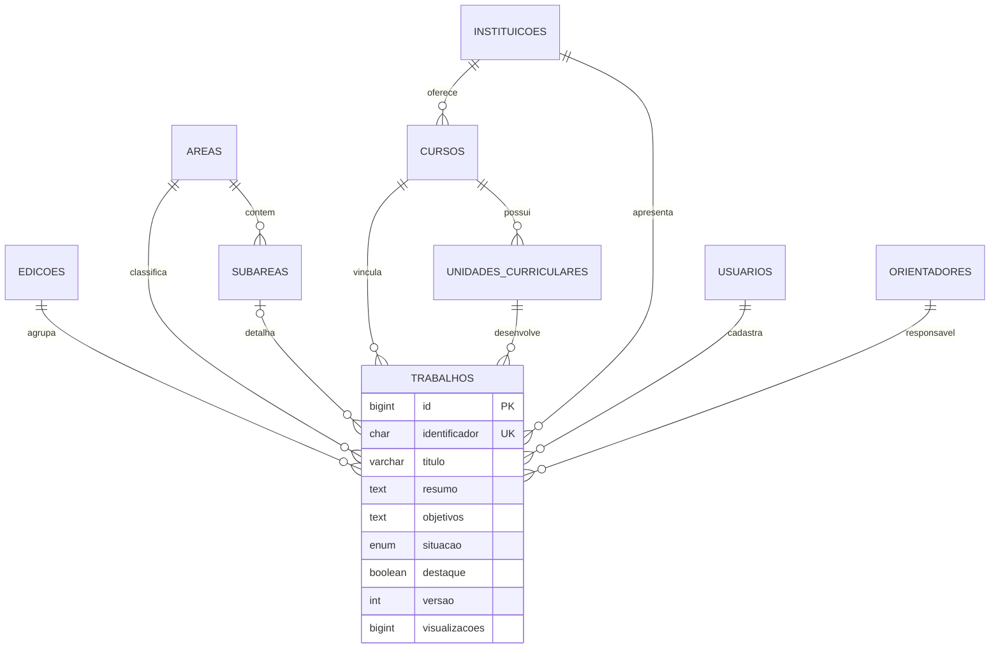
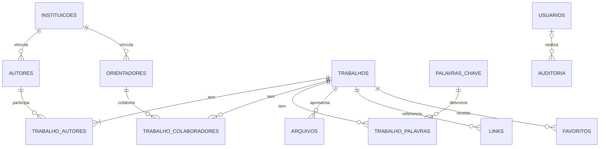

# Arquitetura e modelagem

## Fluxo e camadas

O controlador é `public/index.php`; views não executam alterações de dados. `ProjectRepository` centraliza os filtros públicos, tanto para resultados quanto para contadores. `ProjectService` grava projeto e associações na mesma transação. Os serviços de catálogo usam listas explícitas de entidades e campos. Arquivos são servidos por ID após consultar a situação do projeto e a sessão.

## Modelo central

## Pessoas, temas e materiais

Há ainda `login_tentativas`, com hash de IP e índice por data. `favoritos` usa chave composta visitante/projeto, sem cadastro pessoal de visitante. O mínimo de um autor no diagrama representa a regra da aplicação; no SQL isolado ele depende da transação do serviço. Um professor responsável fica diretamente em `trabalhos`; colaboradores em tabela intermediária.

## Restrições e normalização

- Chaves substitutas numéricas, identificador público aleatório único, e nomes únicos conforme o contexto (ex.: curso/instituição).
- Associações N:N em tabelas próprias com PK composta. Não se armazenam autores ou palavras-chave separados por vírgulas no registro do projeto.
- FKs compostas de curso/instituição, UC/curso e subárea/área impedem associação incompatível.
- Posições de autores limitadas a 1–5; colaboradores a 1–3, com unicidade por projeto.
- Exclusão em cascata apenas nas dependências do projeto. Instituição/curso/pessoas utilizados têm exclusão restrita por FK.
- Versão controla edição concorrente. Contagens derivam das consultas, não de totais gravados manualmente.
- Índices nas situações/edições/áreas, destaques, curso e título. Busca com `%termo%` é flexível, mas pode precisar de FULLTEXT ou outra estratégia após medição em grande volume; não houve benchmark.

## Permissões

| Ação | Visitante | Editor | Administrador |
|---|---|---|---|
| Consultar publicados, pesquisar, baixar materiais públicos | Sim | Sim | Sim |
| Favoritar/compartilhar | Sim, por sessão | Sim | Sim |
| Ver rascunhos e arquivos privados no painel | Não | Sim | Sim |
| Criar/editar/publicar/arquivar e gerenciar materiais | Não | Sim | Sim |
| Excluir projeto | Não | Não | Sim |
| Cadastros auxiliares, contas e auditoria | Não | Não | Sim |

Não há autorização por proprietário: o editor é um perfil editorial global. Isso está alinhado à descrição dos perfis; se futuramente houver autores com conta, deve ser acrescentado controle por vínculo/propriedade antes de abrir o painel a esse público.
